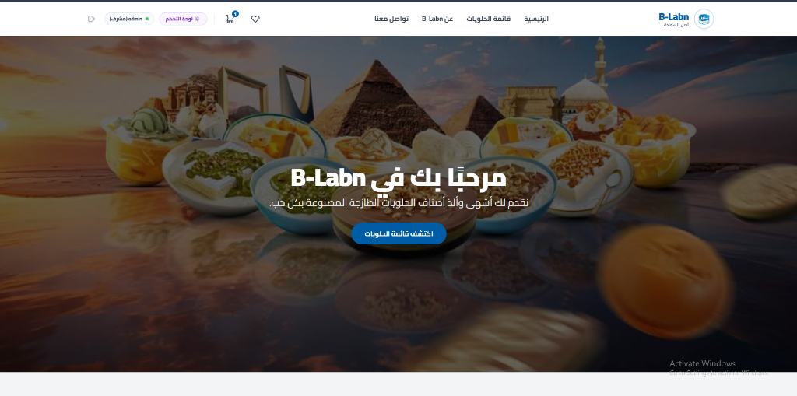
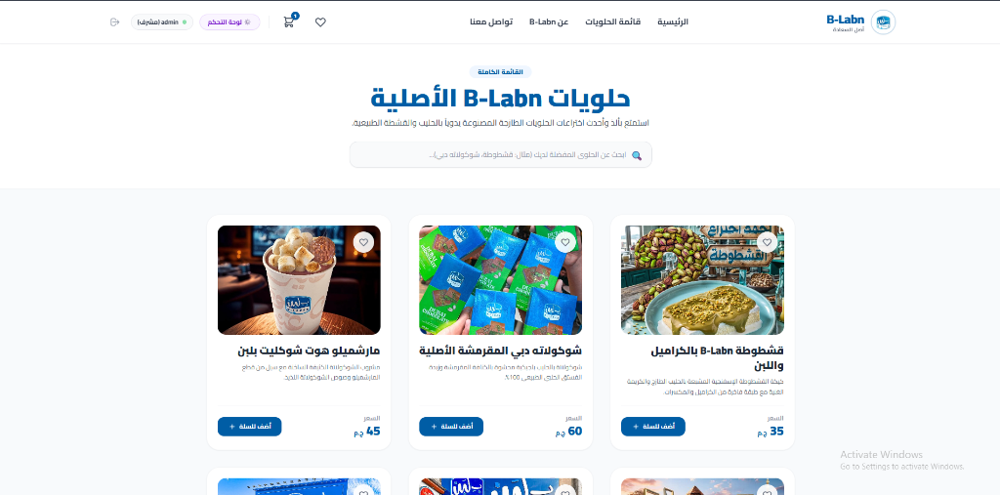
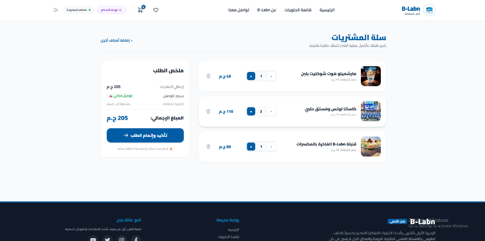
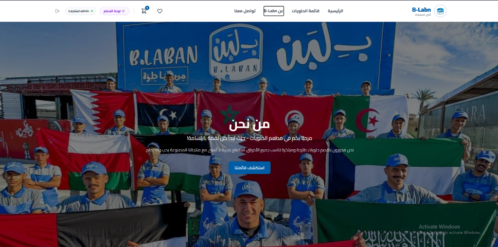

# 🍨 B-Labn (بلبن) - Modern E-Commerce Platform

<div align="center">



[](https://nodejs.org/)
[](https://expressjs.com/)
[](https://www.mongodb.com/)
[](https://vitejs.dev/)
[](https://developer.mozilla.org/en-US/docs/Web/JavaScript)
[](LICENSE)

**منصة تجارة إلكترونية عصرية وسريعة مستوحاة من حلويات "بـ لبن" الشهيرة**  
*A modern, high-performance Single Page Application (SPA) e-commerce solution built with Vanilla JavaScript, Vite, Express.js, and MongoDB Atlas.*

[المميزات](#-أبرز-المميزات--key-features) • [معرض الصور](#-معرض-الشاشات--ui-showcase) • [التقنيات المستخدمة](#-التقنيات-المستخدمة--tech-stack) • [التشغيل السريع](#-دليل-التثبيت-والتشغيل--quick-start) • [توثيق الـ API](#-توثيق-واجهة-البرمجة--api-endpoints) • [بيانات الحسابات التجريبية](#-حسابات-الدخول-التجريبية--demo-credentials)

</div>

---

## 📖 نظرة عامة (Overview)

**B-Labn** هو تطبيق ويب متكامل للتجارة الإلكترونية مصمم خصيصاً لخدمة محبي الحلويات الشرقية والمبتكرة (مثل القشطوطة، شوكولاتة دبي المقرمشة، كاساتا اللوتس، وأم علي بالسمن البلدي).

تم بناء الواجهة الأمامية بدون أطر عمل معقدة لتوفير أقصى قدر من الأداء والخفة، مع الاعتماد على **Single Page Application (SPA)** كاملة باستخدام **Vanilla JavaScript** و **History API**، ومتصلة بخادم خلفي قوي مبني على **Node.js & Express** وقاعدة بيانات سحابية **MongoDB Atlas**.

---

## ✨ أبرز المميزات (Key Features)

### 🛍️ تجربة مستخدم سلسة وعصرية (Customer Experience)
- **توجيه أحادي الصفحة (Zero-Reload SPA Router):** تنقل فوري وفائق السرعة بين الصفحات دون إعادة تحميل المتصفح.
- **سلة مشتريات ديناميكية (Dynamic Cart System):** تحديث فوري لكميات وأسعار المنتجات، حساب إجمالي الطلب، وتخزين محلي عبر `localStorage`.
- **نظام الإشعارات التفاعلي المخصص (Custom Toast Alerts):** استبدال تنبيهات المتصفح الافتراضية القديمة بنظام تنبيهات Toast عصري وناعم.
- **شارات حية في شريط التنقل (Live Badges):** عرض حي لعدد العناصر داخل السلة وقائمة المفضلة في الهيدر.
- **بحث وتصفية ذكية:** تصفية فورية لقائمة الحلويات بمجرد كتابة اسم المنتج.
- **قائمة مفضلة (Wishlist):** تمكين المستخدم من حفظ منتجاته المفضلة والتفاعل معها بلمسة واحدة.
- **دعم اللغة العربية والاتجاه (RTL Support):** واجهة متكاملة تدعم الخطوط العربية وتجربة استخدام طبيعية.

### ⚙️ لوحة تحكم الإدارة (Admin Dashboard & CRUD)
- **إدارة كاملة للمنتجات (Full CRUD):**
  - استعراض جميع المنتجات المتاحة بتنسيق بطاقات أنيق.
  - إضافة منتجات جديدة مع تحديد السعر والصورة والوصف والتصنيف.
  - **تعديل المنتجات الحالية** وتحديث بياناتها فورياً.
  - حذف المنتجات مع تأكيد الحذف وتحديث الصفحة بدون إعادة تحميل.
- **إدارة المستخدمين:** استعراض قائمة الأعضاء المسجلين مع إمكانية التحكم والحذف.
- **أمان وحماية المسارات (Route Guards):** منع الوصول غير المصرح به للوحة التحكم وقصرها على دور المشرف (`role: 'admin'`).

### 🔐 الأمان وحماية البيانات (Security & Architecture)
- **المصادقة والتفويض:** تشفير كلمات المرور باستخدام `bcryptjs` وإصدار رموز المصادقة عبر `JSON Web Tokens (JWT)`.
- **حماية أسرار النظام والبيئة:** عزل كامل للمفاتيح الحساسة في ملفات `.env` غير المتتبعة في Git، مع تنظيف التاريخ البرمجي من أي أسرار.
- **هيكلية كود نظيفة (Modular Architecture):** تقسيم الواجهة لمكونات وصفحات وخدمات API مستقلة، وتنظيم الباك إند وفق نمط MVC.

---

## 📸 معرض الشاشات (UI Showcase)

<div align="center">

### 1. الصفحة الرئيسية والبانر الترحيبي (Hero & Home)


---

### 2. قائمة الحلويات والبحث المباشر (Menu & Search)


---

### 3. سلة المشتريات وإتمام الطلب (Cart & Checkout)


---

### 4. قصة المتجر والتواصل (About & Brand Story)


</div>

---

## 🛠️ التقنيات المستخدمة (Tech Stack)

### 🎨 الواجهة الأمامية (Frontend)
- **JavaScript (ES6+):** بنية معيارية (Modules)، معالجة الأحداث التفاعلية، وإدارة الحالة.
- **Vite:** مجمّع ومطور فائق السرعة مع دعم Hot Module Replacement (HMR).
- **HTML5 & CSS3:** تصميم متجاوب (Responsive Web Design) يدعم كافة الشاشات وأجهزة الجوال.
- **Font Awesome 6:** أيقونات حديثة وجذابة لجميع الإجراءات والأزرار.

### 🖥️ الواجهة الخلفية (Backend)
- **Node.js:** بيئة تشغيل جافاسكريبت عالية الكفاءة وغير متزامنة.
- **Express.js:** إطار عمل خفيف لبناء واجهات برمجة التطبيقات (RESTful APIs).
- **Mongoose ODM:** نمذجة بيانات المنتجات والمستخدمين والتحقق من صحتها.
- **JSON Web Token (JWT):** إدارة الجلسات والمصادقة الآمنة عبر التوكن.
- **bcryptjs:** تشفير وحماية كلمات المرور وفق معايير الأمان العالمية.
- **CORS & dotenv:** إدارة سياسات الوصول ومتحولات البيئة بأمان.

### 🗄️ قاعدة البيانات (Database)
- **MongoDB Atlas:** قاعدة بيانات سحابية NoSQL موزعة وقابلة للتوسع.

---

## 👥 حسابات الدخول التجريبية (Demo Credentials)

لتسهيل تجربة وتقييم المشروع، تتوفر حسابات معدة مسبقاً في قاعدة البيانات:

| الدور (Role) | البريد الإلكتروني (Email) | كلمة المرور (Password) | الصلاحيات (Privileges) |
| :--- | :--- | :--- | :--- |
| **مشرف (Admin)** | `admin@b-labn.com` | `admin123456` | وصول كامل للوحة التحكم، إضافة/تعديل/حذف المنتجات، وإدارة المستخدمين |
| **مستخدم (User)** | `user@b-labn.com` | `user123456` | تصفح القائمة، الشراء، استخدام السلة والمفضلة |

---

## 🚀 دليل التثبيت والتشغيل (Quick Start)

### المتطلبات الأساسية (Prerequisites)
- تثبيت [Node.js](https://nodejs.org/) (الإصدار 18 أو أحدث).
- تثبيت [Git](https://git-scm.com/).
- حساب أو اتصال بقاعدة بيانات [MongoDB Atlas](https://www.mongodb.com/atlas).

### 1. استنساخ المستودع (Clone Repository)
```bash
git clone https://github.com/YOUR_USERNAME/b-Labn.git
cd b-Labn
```

### 2. إعداد وتشغيل الخادم الخلفي (Backend Server)
```bash
cd server
npm install
```

قم بإنشاء ملف `.env` داخل مجلد `server/` وأضف المتغيرات التالية:
```env
PORT=5000
MONGO_URI=mongodb+srv://<username>:<password>@<cluster>.mongodb.net/b-laban?retryWrites=true&w=majority
JWT_SECRET=your_jwt_secret_key_here
```

*(اختياري)* لملء قاعدة البيانات بالمنتجات الأصلية والحسابات التجريبية:
```bash
npm run seed
```

تشغيل الخادم:
```bash
npm start
# أو للتشغيل مع إعادة التحميل التلقائي:
npm run dev
```
> يعمل الخادم بشكل افتراضي على: `http://localhost:5000`

---

### 3. إعداد وتشغيل الواجهة الأمامية (Frontend Client)
افتح نافذة طرفية (Terminal) جديدة:
```bash
cd client
npm install
```

قم بإنشاء ملف `.env` داخل مجلد `client/`:
```env
VITE_BASE_URL=http://localhost:5000
```

تشغيل خادم التطوير:
```bash
npm run dev
```
> سيفتح التطبيق في المتصفح عبر: `http://localhost:3000` (أو البورت المعروض في الطرفية).

---

## 📡 توثيق واجهة البرمجة (API Endpoints)

### 🔐 المصادقة (Authentication)
| الطريقة | المسار | الوصف | الصلاحية |
| :--- | :--- | :--- | :--- |
| `POST` | `/api/auth/register` | تسجيل مستخدم جديد | للجميع |
| `POST` | `/api/auth/login` | تسجيل الدخول وإرجاع الـ JWT | للجميع |

### 🍰 المنتجات (Products)
| الطريقة | المسار | الوصف | الصلاحية |
| :--- | :--- | :--- | :--- |
| `GET` | `/api/product/all` | جلب جميع منتجات القائمة | للجميع |
| `POST` | `/api/product/add` | إضافة منتج جديد | مشرف فقط (`Admin`) |
| `PUT` | `/api/product/:id` | تعديل بيانات منتج موجود | مشرف فقط (`Admin`) |
| `DELETE` | `/api/product/:id` | حذف منتج من القائمة | مشرف فقط (`Admin`) |

### 👤 إدارة المستخدمين (Admin Management)
| الطريقة | المسار | الوصف | الصلاحية |
| :--- | :--- | :--- | :--- |
| `DELETE` | `/api/admin/users/:id` | حذف مستخدم من النظام | مشرف فقط (`Admin`) |

---

## 📂 هيكلية المشروع (Project Structure)

```text
b-Labn/
├── client/                      # كود الواجهة الأمامية (SPA)
│   ├── src/
│   │   ├── css/                 # ملفات التنسيق والـ Stylesheets
│   │   │   └── style.css
│   │   └── js/                  # منطق الجافاسكريبت المكتبي
│   │       ├── api/             # استدعاءات الـ REST API
│   │       │   ├── auth.js
│   │       │   └── products.js
│   │       ├── components/      # المكونات القابلة لإعادة الاستخدام (Navbar, Toast, Modals)
│   │       │   ├── navbar.js
│   │       │   └── toast.js
│   │       ├── pages/           # صفحات التطبيق (Home, Menu, Cart, About, Dashboard)
│   │       │   ├── about.js
│   │       │   ├── cart.js
│   │       │   ├── dashboard.js
│   │       │   ├── home.js
│   │       │   ├── login.js
│   │       │   ├── menu.js
│   │       │   └── register.js
│   │       ├── router/          # محرك التوجيه (Client-Side Router)
│   │       │   └── router.js
│   │       └── main.js          # نقطة انطلاق التطبيق (Entrypoint)
│   ├── index.html               # القالب الرئيسي لـ SPA
│   ├── package.json
│   └── vite.config.js
│
├── server/                      # كود الواجهة الخلفية (REST API)
│   ├── controllers/             # دوال التحكم بالعمليات (Auth, Products, Users)
│   ├── middleware/              # برمجيات التحقق وحماية التوكن والصلاحيات
│   ├── models/                  # نماذج قاعدة البيانات (Mongoose Models)
│   ├── routes/                  # مسارات الـ API
│   ├── seed.js                  # سكربت تهيئة البيانات الافتراضية
│   ├── server.js                # ملف تشغيل السيرفر الرئيسي
│   └── package.json
│
├── docs/                        # التوثيق والوسائط
│   └── screenshots/             # لقطات الشاشة التوضيحية
│       ├── home.png
│       ├── menu.png
│       ├── cart.png
│       └── about.png
│
├── .gitignore                   # حماية ملفات البيئة والتبعيات
└── README.md                    # دليل المشروع الرئيسي
```

---

## 🛡️ أمان البيانات ورفع المشروع (Git & Environment Security)

- تم إعداد ملفات `.gitignore` بعناية فائقة على مستوى المستودع الرئيسي والمجلدين الفرعيين لمنع رفع أي ملفات سرية أو مفاتيح (`.env`, `.env.*`, `node_modules`).
- تم تنظيف سجل Git بالكامل لضمان خلوه التام من أي مفاتيح تاريخية.

للرفع إلى مستودعك على GitHub:
```bash
git push --force origin main
```

---

## 👨‍💻 المساهمة والتطوير (Contribution)

المساهمات مرحب بها دائماً! إذا كانت لديك أفكار لتطوير المشروع أو إضافة مزايا جديدة:
1. قم بعمل **Fork** للمستودع.
2. أنشئ فرعاً لميزتك (`git checkout -b feature/AmazingFeature`).
3. سجّل التعديلات (`git commit -m 'Add some AmazingFeature'`).
4. ارفع الفرع (`git push origin feature/AmazingFeature`).
5. افتح **Pull Request**.

---

<div align="center">

صُنع بكل ❤️ لمحبي حلويات **بـ لبن** • Developed with Passion for Great Desserts & Clean Code

</div>
